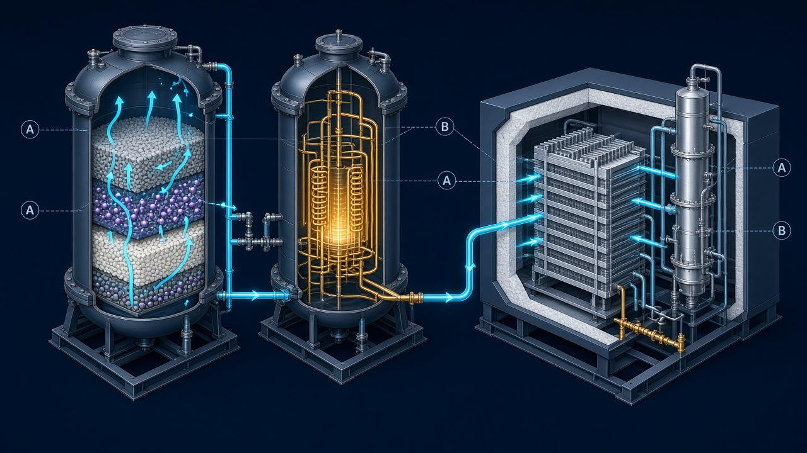

# Cryogenic Feed Purification — 34s (1,020-Frame) Code-Driven Anatomy Explainer

**Live GitHub Pages Preview:** [https://mizcausevic-dev.github.io/cryogenic-feed-purification-explainer/](https://mizcausevic-dev.github.io/cryogenic-feed-purification-explainer/)



A deterministic, frame-indexed (`0–1019`, `34.00s @ 30 fps`) interactive anatomy explainer and technical editorial dissecting **cryogenic feed purification (Pre-Purification Unit / PPU)** upstream of an industrial Air Separation Unit (ASU) cold box.

---

## GitHub Repository Metadata

* **About (One-Line Description):** Deterministic 34s (1,020-frame @ 30fps) code-driven anatomy explainer of cryogenic feed purification (H2O/CO2 removal, thermal regeneration, and cold-box protection).
* **Topics:** `cryogenics`, `air-separation-unit`, `pre-purification-unit`, `molecular-sieve`, `temperature-swing-adsorption`, `chemical-engineering`, `deterministic-simulation`, `html5-canvas`, `typescript`, `scientific-visualization`

---

## Visual Direction & Explanatory Color Ontology

Colors in this visualization are **functional explanatory overlays**, not literal optical emission:

* **Dark Technical Stage (`#0B1019`):** High-contrast orthographic/isometric engineering viewport.
* **Neutral Structural Materials (`#344257`):** Pressure vessels, support grids, piping headers, and cold-box casing.
* **Cyan (`#00E5FF`):** Primary mass transport / dry carrier gas (`N₂` / `O₂` / `Ar`) and lower-bed moisture (`H₂O`) capture front.
* **Gold (`#FFD166`):** Energy and actuation—compression shaft work (`+W_comp`), exothermic heat of adsorption (`+ΔH_ads`), and regeneration heater duty (`+Q̇_desorb`).
* **Violet (`#9D4EDD`):** Control interlocks (`AI-201`, `PDI-202`), switching valve states, selective `CO₂` capture in the upper molecular-sieve zone, and the breakthrough uncertainty band.

---

## 5-Act Camera & Mechanism Choreography (`1,020` Frames @ `30 fps`)

| Act | Frames | Time | Camera & Mechanism Directive |
| :--- | :--- | :--- | :--- |
| **Act I** | `0–149` | `0.0s–5.0s` | **Reveal Upstream Assembly:** Establishes Main Air Compressor (MAC), aftercooler, and twin adsorbent vessels (`Vessel A` & `Vessel B`) upstream of the cold box, then executes a measured three-quarter push toward the active adsorption region. |
| **Act II** | `150–299` | `5.0s–10.0s` | **Selective H₂O & CO₂ Removal:** `2.22×` sectional close-up of `Vessel A`. Isolates the graded bed: lower activated alumina / desiccant layer removes `H₂O` vapor first; upper `13X` zeolite molecular-sieve layer captures `CO₂` ahead of the advancing Mass Transfer Zone (`MTZ`). |
| **Act III** | `300–509` | `10.0s–17.0s` | **Track Purified Feed & Control Interlocks:** Follows contaminant-free dry air exiting `Vessel A` through `KV-201` and the particulate afterfilter (`#00E5FF`) while keeping trace-`CO₂` analyzer (`AI-201`) and differential-pressure (`PDI-202`) control signals (`#9D4EDD`) visually distinct. |
| **Act IV** | `510–749` | `17.0s–25.0s` | **Conceptual Regeneration State:** Pans to `Vessel B` and the regeneration heater (`#FFD166`), showing counter-current (top-to-bottom) dry waste-nitrogen purge stripping bound `CO₂` and `H₂O` to vent (`KV-302`), paired with a synchronized qualitative thermal-pulse and elution inset. |
| **Act V** | `750–1019` | `25.0s–34.0s` | **Protect Downstream Low-Temperature Equipment:** Pulls back to a stable system-wide overview showing the protected Brazed Aluminum Heat Exchanger (`BAHX`), turboexpander, and distillation column inside the cold box while retaining visible `ΔP` loss, purge overhead, and breakthrough uncertainty. |

---

## Technical Limits & Reference Scope

* **Mechanism Reference:** [Air Products — Cryogenic Nitrogen Plant (On-Site Gas Generation)](https://www.airproducts.com/supply-modes/gen-gas-on-site/onsite-nitrogen-generation/cryogenic-nitrogen-plant)
* **Technical Limits:** Adsorbents and regeneration cycles vary across industrial plants. No regeneration recipe or total contaminant-removal guarantee is claimed.
* **Reference Scope:** The reference supports the underlying process sequence and architecture. Camera moves, palette, cutaways, and timing are original illustrative directions, not experimentally validated observations, certified designs, or operating instructions for hazardous equipment.

---

## Running Locally

```bash
# Install dependencies
npm install

# Start local development server (runs on http://127.0.0.1:43123)
npm run dev

# Type-check and build production bundle into dist/
npm run build
```

## Included Deliverables

* `src/simulationEngine.ts` — Pure deterministic 1,020-frame state & camera evaluator (`computeFrameState(0..1019)`).
* `src/canvasRenderer.ts` — 1600×900 orthographic/isometric Canvas cutaway renderer with HUD disclosures, conservation ledger, and qualitative breakthrough diagrams.
* `medium-article-Claude.md` / `medium-article-Cursor.md` — Full SEO/GEO/AEO-optimized Medium technical article.
* `public/cryogenic-purification-hero.jpg` — Custom 16:9 technical cutaway Hero illustration.
* `dashboard-Claude.html` / `dashboard-Cursor.html` — Standalone single-file 7-theme strategy & architecture visualization dashboard.
