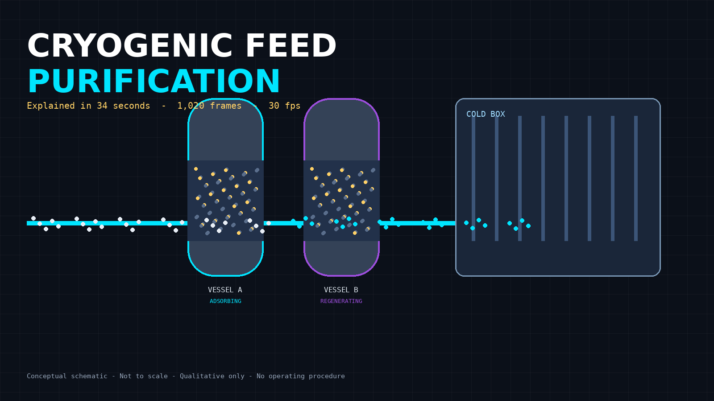

# Cryogenic Feed Purification, Explained in 34 Seconds: Why the Cold Box Cannot Clean Its Own Feed

**Subtitle:** A frame-accurate, code-driven anatomy of the step that removes water and carbon dioxide before air gets cold. 1,020 frames. Five phases. No recipe. No guarantee. Just the mechanism.

**SEO title (60 characters):** Cryogenic Feed Purification Explained in 34 Seconds
**Meta description:** How adsorbent vessels remove water and CO2 upstream of a cryogenic cold box, how regeneration works conceptually, and why downstream low-temperature equipment depends on that order. A 1,020-frame, code-driven explainer.
**Primary keyword:** cryogenic feed purification
**Secondary keywords:** front-end purification, cryogenic air separation, adsorbent vessels, cold box, water and CO2 removal, industrial gases, cryogenic nitrogen plant
**Tags for Medium:** Cryogenics, Industrial Gases, Chemical Engineering, Process Engineering, Air Separation

*Hero: Feed purification sits upstream of the cold box for a reason. Conceptual schematic. Not to scale. Qualitative only.*

---

## BLUF

If you cool untreated air far enough, the water and carbon dioxide in it stop behaving like gases and start behaving like solids. They freeze out where you least want solid: inside narrow, cold passages.

So cryogenic plants do not ask the cold box to handle that problem. They purify the feed first.

That is the entire film in one sentence. The remaining 34 seconds show the order, the accounting, and the limit of the claim.

Watch the interactive version, scrub it frame by frame, and export stills here: **[Live explainer: Cryogenic Feed Purification](https://example.com/replace-with-github-pages-url)**

> Replace the link above with the published GitHub Pages URL before posting to Medium. Do not publish a placeholder URL as a live claim.

---

## The problem is not cold. The problem is what cold does to trace species.

A cryogenic air separation plant makes its money by cooling air until its components can be separated at low temperature. Air Products describes cryogenic nitrogen generation as a route to on-site nitrogen supply, and the public process description supports the underlying architecture this explainer uses as a reference: feed is prepared, then it enters low-temperature separation.

This article does not reproduce a vendor design. It uses that public architecture as a basis for a conceptual schematic. Camera moves, palette, cutaways, and timing in the film are original illustrative direction. They are not measurements, not a simulation, and not a certified design.

The mechanism that matters here is older and simpler than any single product:

1. Feed air carries water vapour and carbon dioxide with it.
2. An adsorbent bed can hold those species on a solid surface while the bulk gas passes.
3. The bed has finite capacity in a given state. When it has held enough, it must be taken off feed and regenerated, while another vessel carries the duty.
4. The purified stream then proceeds to the cold box.
5. Downstream equipment stays protected only while the upstream step is actually doing its work.

None of that requires a number to understand. In fact, adding invented numbers would make it less true.

## Why this film has no temperatures, pressures, or efficiencies

The brief for this explainer set a hard rule, and it is the right rule for public technical content:

- Do not invent dimensions, materials, operating settings, efficiencies, safety certifications, vendor internals, or performance gains.
- Keep graphs qualitative unless actual data supports them.
- Do not provide a regeneration recipe.
- Do not promise total contaminant removal.

That restraint is not a gap in the work. It is the editorial position.

Adsorbents and cycles vary. Bed media, vessel arrangement, switching logic, purge source, and regeneration conditions depend on the design and the duty. A public explainer that printed a temperature or a cycle time without a sourced design basis would be giving you a number you cannot check and should not use. Worse, in this domain a plausible-looking recipe can read like an operating instruction for hazardous equipment. This film deliberately does not cross that line.

What it gives you instead is accounting. Mass does not disappear. What the bed holds in one state, it releases in another.

## Phase 1 (0 to 5 seconds, frames 0 to 149): Establish order before detail

The film opens wide. Two adsorbent vessels sit upstream of a cold box. Feed enters from the left. The cold box is downstream on the right.

The colours are a legend, not a photograph:

- **Cyan** means transport or signal. It shows where gas moves.
- **Gold** means energy or actuation. It marks the moments and places where work is applied.
- **Violet** means control or state. It tells you which vessel is doing which job.
- **Neutral grey-blue** means structure. Vessels and equipment are not glowing in real life. The overlay is explanatory.

The camera makes a measured three-quarter push toward the active region. No cut hides a transition. You watch the system narrow from "whole plant concept" to "the vessel that is currently on feed."

That opening matters because most misunderstanding in cryogenics starts with order. If you think purification happens inside the cold box, everything after that will confuse you. It does not. It happens before.

## Phase 2 (5 to 10 seconds, frames 150 to 299): The sectional close-up

The second phase cuts the active vessel open. This is a conceptual section, not a material specification. Bed depth, media type, support, and internals vary and are not claimed.

Inside, two populations separate:

- Pale particles labelled H2O and CO2 approach the bed.
- Gold markers accumulate on the solid phase. They have been retained.
- A cyan stream leaves, depleted in those species.

Read that wording carefully. Depleted, not certified pure. The film never stamps the outlet as zero. It shows a direction of change, because direction is what the mechanism supports without data.

This is also where a common visual lie gets avoided. Many explainers show contaminants vanishing at a filter line. Nothing vanishes here. Retained species stay visible on the bed. If you cannot see where something went, an explainer has hidden the accounting from you. In separation processes, always ask where the removed material is right now. In this phase, the answer is: on the bed.

## Phase 3 (10 to 17 seconds, frames 300 to 509): Track the purified feed, keep the overlays honest

Phase three follows the purified stream toward the cold box along the primary causal pathway. The camera tracks rather than cuts, so you keep your place in the system.

Three visual channels stay separate for a reason:

- Cyan tracks mass. If it moves, gas moves.
- Gold flashes only at valve actuation moments. It does not smear along the pipe, because actuation is an event, not a flow.
- Violet stays on the control line at the bottom. It reports state. It never enters the pipe, because a signal is not a stream.

That separation is a small design decision with a large teaching payoff. Process diagrams fail readers when one colour does three jobs. Here, if you see violet in a pipe in any frame, the film has broken its own rule. It does not.

No flow rate, pressure drop, or temperature approach is numbered in this phase. None was supplied, and a qualitative pathway does not need one to be useful. The question being answered is where the stream goes and what has already been removed from it, not how much a specific plant moves on a specific day.

## Phase 4 (17 to 25 seconds, frames 510 to 749): Regeneration, shown as a separate state, not a recipe

A bed that only ever adsorbs is a bed that eventually stops working. So the system needs a second state.

In phase four, vessel A stays on feed while vessel B regenerates. A warm purge, shown as a gold wash, flows through B in reverse. Desorbed water and carbon dioxide leave by a separate outlet at the top. A violet badge renames the vessel state. The two vessels are never shown doing the same job at the same time.

Then the film stops, deliberately, before becoming a procedure.

It does not tell you a purge temperature. It does not tell you a flow, a duration, a pressure, or a switching sequence. It does not tell you how a real plant sources its purge gas. Those are design and operating details. Giving invented versions of them in a public article would be irresponsible, and giving real versions for a specific plant would be an operating instruction. Neither belongs here.

What you get is the concept and the accounting:

- Energy is applied (gold).
- Flow direction reverses relative to adsorption.
- Retained species leave the bed and exit the system boundary by a defined outlet.
- Bed loading, shown in the qualitative inset, falls.

The inset graph has no units and no numbers on its axes. It is labelled qualitative, not measured. It says loading rises during adsorption and falls during regeneration. That shape is the mechanism. A precise curve would require cycle data this explainer does not have, and presenting one would be fabrication dressed as rigour.

If you take one sentence from this phase, take this: regeneration is not cleaning in the household sense. It is moving the same mass out of the solid phase and out of the vessel so the vessel can hold mass again.

## Phase 5 (25 to 34 seconds, frames 750 to 1019): Pull back to the reason it all exists

The final phase reverses the opening move. The camera pulls back to a stable system overview and holds it. Explainer films should end on the whole system, not on their most dramatic close-up, because the claim lives at system level.

On the left of the cold box, a faint dashed ghost marks a conditional risk: if untreated feed reached low temperature, freeze-out could threaten narrow passages. Note the grammar. The ghost is labelled risk, not event. The film does not show a blockage happening. It shows why upstream removal is protective, without staging a failure it cannot quantify.

The purified passage stays open. The retained species stay accounted for. The control line still reports which vessel holds which state.

And the limits stay on screen. That last choice is intentional. Downstream protection is conditional on bed state, feed condition, and cycle integrity. A film that ended with "equipment protected, forever, completely" would be selling a guarantee no adsorbent system can honestly make. This one ends with "protected when the upstream step is working," which is the strongest claim the mechanism supports.

## How to use this film in a real room

**In training.** Pause at frame 150 and ask where the removed water is right now. If the answer is "gone," replay phase two. Then pause at the phase four boundary and ask what changed besides flow direction. The state badge, the outlet path, and the falling loading curve should all be named.

**In a sales or qualification conversation.** Use phase one to establish order, then stop. Prospects who understand why purification sits upstream ask better questions about the whole plant. Do not use the film to imply a removal efficiency or a cycle performance figure. It contains none, on purpose.

**In design review.** Use the film as a communication check, not a design check. It can confirm that a team shares the same causal picture. It cannot confirm sizing, media selection, valve sequencing, or relief philosophy. Those need real engineering artefacts.

**In content and SEO.** The film is built as deterministic code. Every frame is a function of a frame number from 0 to 1019 at 30 frames per second. That makes stills exportable for slides, thumbnails, and documentation without re-rendering a video edit. The same code structure repurposes to other cyclic separations (instrument air dryers, guard beds, solvent recovery) by changing the retained species and labels. The architecture of the explanation survives the change of chemistry.

## What this explainer is not

It is not a certified design. It is not a simulation result. It is not a substitute for a plant P&ID, an adsorbent vendor datasheet, or an operating procedure. It does not certify that any specific installation removes any specific amount of any contaminant. It gives no instruction for operating hazardous equipment, and nothing in it should be used that way.

It is a labelled conceptual schematic with a running clock, an honest legend, and its limits printed on the stage.

## The editorial test this kind of content should pass

Industrial content earns trust the same way industrial equipment does: by showing its accounting and naming its limits under load.

Before you publish any technical explainer in this sector, ask four questions:

1. Can the viewer always say where the removed material is?
2. Are transport, energy, and control visually distinct, or does one colour do every job?
3. Is every graph either sourced from data or labelled qualitative?
4. Does the content refuse to become an operating instruction, even when a recipe would get more clicks?

This film was built to pass those four. If you reuse the pattern, hold the same line.

---

## Watch, scrub, steal the stills

- **Live interactive explainer:** [GitHub Pages link to be inserted on publication]
- **Source code:** [GitHub repository link to be inserted on publication]
- **Hero image:** included with the repository under `public/hero-cryogenic-feed-purification.png`
- **Format:** 34 seconds, 30 fps, 1,020 frames (0 to 1019), deterministic canvas rendering, no video file required

If you build training, documentation, or buyer education for industrial gases and want explainers held to this standard (mechanism first, accounting visible, limits on screen, no invented numbers), that is the work Kinetic Gain does.

**Call to action:** Watch the film once at full speed. Then scrub phase four slowly. If you can explain, out loud, where the water is at frame 600, you understand front-end purification better than most diagrams will ever teach you.

---

### Sources and basis

- Air Products. Cryogenic nitrogen plant / on-site nitrogen generation (cryogenic air separation). Used as the basis for process architecture only. https://www.airproducts.com/supply-modes/gen-gas-on-site/onsite-nitrogen-generation/cryogenic-nitrogen-plant

### Production note

Reference scope: the reference supports the underlying process or architecture. Camera moves, palette, cutaways, and timing are original illustrative directions, not experimentally validated observations. This article and film are not a certified design, simulation result, or claim about a specific commercial implementation. Numerical graphs are qualitative unless stated otherwise. Scale is changed and labelled. Time is compressed and labelled. No dimensions, materials of construction, operating settings, efficiencies, certifications, or vendor internals are claimed.

*Written for engineers, trainers, and technical buyers who would rather have an honest schematic than a confident number with no source behind it.*
