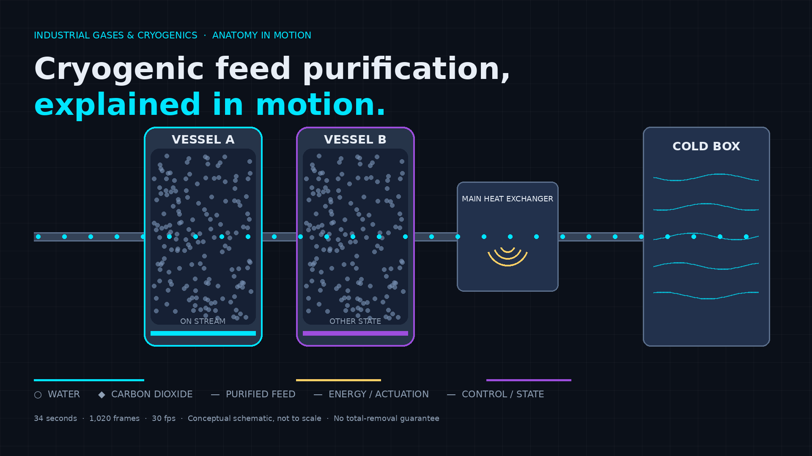

# Before Air Gets Cold, It Has to Get Clean

## Cryogenic feed purification, explained in 34 seconds of code

*How adsorbent vessels remove selected water and carbon dioxide upstream of the cold box, why the off-stream vessel matters as much as the on-stream one, and what this mechanism does not promise.*

---

Most explanations of cryogenic air separation start at the dramatic part: the cold box, the distillation, the liquid. That is the wrong place to start if you want to understand why the plant works at all.

The decisive step happens earlier, at ordinary temperatures, in vessels that look unremarkable from the outside. Compressed air still carries water vapour and carbon dioxide. Cool that air far enough and those two components stop being trace impurities. They become solids. In narrow, cold passages, solid deposition is not a quality problem. It is a blockage pathway.

So the feed is purified before it is deeply cooled. That sequencing, purify first, cool second, is the whole idea. Everything else in this piece is mechanism underneath it.

I built a 34-second, code-driven explainer to make that mechanism inspectable: 1,020 frames at 30 frames per second, drawn by a single deterministic canvas function. You can scrub it, step it frame by frame, and cite any state by number. This article is the companion text. It says what the film shows, what it deliberately does not show, and why.

**Watch it here:** [Live explainer](https://mizcausevic-dev.github.io/cryogenic-feed-purification-explainer/)

---

## The problem purification solves

Air separation by cryogenic distillation depends on cooling compressed air to very low temperatures, then separating components by their different boiling behaviours. Air Products describes this family of plants in its overview of [cryogenic nitrogen generation](https://www.airproducts.com/supply-modes/gen-gas-on-site/onsite-nitrogen-generation/cryogenic-nitrogen-plant), including on-site supply configurations.

Water and carbon dioxide interfere with that cooling step for a physical reason. As temperature falls, their capacity to stay in the gas phase falls with it. If they enter the cold end in sufficient quantity, they can freeze out and deposit in heat-exchanger passages and other restricted paths. The consequence is practical: rising resistance to flow, degraded heat transfer, and eventually a forced interruption to clear the accumulation.

Feed purification exists to break that chain before it starts. Remove the freeze-prone species while the gas is still warm enough to handle them easily, and the cold equipment downstream only has to do the job it was designed for.

That is a mechanism, not a guarantee. How much is removed, for how long, and what breaks through when the adsorbent loads up depend on the adsorbent, the cycle, the feed condition, and the plant. This article claims none of those numbers.

## What an adsorbent vessel actually does

Adsorption is surface capture. A porous solid presents an enormous internal surface area. Certain gas-phase molecules are preferentially held on that surface while the bulk gas passes through. In feed purification for cryogenic service, the targets of interest here are water and carbon dioxide.

Picture the vessel in section. Feed enters, distributes through a bed of adsorbent particles, and leaves with fewer of the captured species in the gas phase. Nothing is burned, reacted away, or wished away. The contaminants are still present. They are held, temporarily, on the solid. That distinction drives everything that follows, because a surface that fills up must eventually be emptied or replaced.

Three accounting rules keep the picture honest:

1. **Mass.** Feed in equals purified feed out plus contaminants held on the bed plus, during regeneration, contaminants carried out with the waste stream. Held inventory rises while a vessel is on stream.
2. **Selectivity.** The bed does not remove everything equally. It preferentially holds selected species. "Purified" means reduced in the targeted components, not absolutely pure.
3. **Capacity.** A bed has finite capacity. Given enough time or loading, targeted species begin to pass through. Engineers call that breakthrough. It is the limit that cycle timing exists to stay ahead of.

The film's second chapter (frames 150 to 299, 5 to 10 seconds) shows exactly this and nothing more: water shown as circles and carbon dioxide as diamonds approaching the bed, a fraction held on particle surfaces, and a leaner stream leaving. The shapes are a coding device. The colours in the film are explanatory overlays, cyan for primary transport, gold for energy or actuation, violet for control or state. They are not literal emissions, temperatures, or concentrations.

## Why there are (conceptually) two vessels

A single bed creates an operational contradiction. It can only adsorb while it has capacity. Restoring capacity takes it out of service. If purification must be continuous, something has to cover the gap.

The standard architectural answer, shown conceptually in the film, is to alternate duties. While one vessel is on stream purifying feed, another is in a different state: being regenerated, standing by, or moving between states. Valves and cycle control (violet in the film) switch the roles before the on-stream bed reaches the point where breakthrough becomes unacceptable.

Treat the two-vessel drawing as an architecture diagram, not a product geometry. Real plants vary in vessel number, size, adsorbent choice, cycle design, and guard arrangements. The film does not specify any of them, because the reference material does not authorise those specifics and inventing them would make the explainer worse, not richer.

## Regeneration, without the recipe

Regeneration is the reversal half of the cycle. A stream, commonly involving heat, a lower-pressure purge, or a combination depending on the cycle type, passes through the off-stream bed in a way that encourages held water and carbon dioxide to release from the surface and leave with a waste outlet. The bed's capacity is restored for its next on-stream period.

Here is what this article will not give you, deliberately: no temperatures, pressures, flows, step times, purge sources, or sequencing instructions. There are two reasons. First, the specifics vary by adsorbent and cycle, so a single recipe presented without context would be false precision. Second, operating instructions for industrial gas equipment belong in controlled plant documentation, not in a public explainer. The film labels this chapter (frames 510 to 749, 17 to 25 seconds) "conceptual" on screen for the same reason, and its inset graph of held inventory falling is explicitly marked qualitative, not measured.

What you should retain is the shape of the idea. Adsorption stores. Regeneration empties. The cycle alternates so that storage is always available somewhere in the system while feed keeps flowing. If you understand that loop, you understand why purification is a cycling process rather than a filter you install and forget.

## Tracking the purified feed into the cold box

Once the targeted species are reduced, the feed proceeds to heat exchange and into the cold box (frames 300 to 509, 10 to 17 seconds). In the film, cyan carries you along that path. Gold appears only where energy is exchanged. Violet appears only at valves and control points. Keeping those three channels visually separate is the difference between an explainer and a light show.

Inside the cold box, the gas gives up heat and approaches the temperatures at which separation becomes possible. This is where the payoff of upstream purification lands. The passages can be narrow because efficient heat exchange rewards surface area and compact geometry. Narrow passages are exactly the ones most vulnerable to freeze-out. Purification does not make the cold box efficient. It makes the cold box's efficiency survivable over operating time.

Notice the direction of causality. Purification is not an accessory bolted onto air separation. It is an enabling precondition for sustained low-temperature operation. Remove it, and the cold end accumulates the very solids it cannot tolerate.

## What protection means, and what it does not

The final chapter (frames 750 to 1019, 25 to 34 seconds) pulls back to the full assembly and stays there. That stable ending is intentional. A good explainer should leave you with the system, not with a climax.

"Protecting downstream equipment" means reducing a known freeze-out and blockage pathway by lowering the water and carbon dioxide load before deep cooling. It does not mean eliminating risk. The film keeps a residual-risk note on screen at the end, listing breakthrough, process upset, and instrument error. Those are not disclaimers for legal decoration. They are the honest boundary of the mechanism:

- Adsorbents and cycles vary. Performance follows the specific system.
- A bed operated beyond its effective capacity will pass contaminants.
- Upsets upstream can change feed loading faster than a nominal cycle assumes.
- No total contaminant-removal guarantee is made here, and none should be inferred from a schematic.

If a vendor, textbook, or colleague gives you actual removal performance, cycle data, or guaranteed outlet specifications, evaluate those against their test conditions and contractual terms. A conceptual film cannot substitute for that evidence, and this one does not try.

## How the film was made, and why code matters

Every frame is rendered by one function of the frame index. There is no video file and no hand-placed keyframe art. Scrub to frame 612 and you will always see the same valve states, particle positions, and labels. That determinism is an editorial choice. Industrial readers do not need more animation. They need animation they can interrogate.

The production constraints were written into the brief before any drawing happened:

- **Duration and rate fixed:** 34 seconds, 30 fps, frames 0 to 1019.
- **Colour discipline:** dark technical stage (#0B1019), neutral materials (#344257), cyan (#00E5FF) for transport, gold (#FFD166) for energy, violet (#9D4EDD) for control.
- **No invented engineering:** no dimensions, materials of construction, operating settings, efficiencies, certifications, or vendor internals.
- **Qualitative graphs only**, labelled as such, because no measured dataset supports quantitative curves.
- **Scale and time manipulation labelled on screen**, including the sectional enlargement and the compressed regeneration cycle.
- **No operating instructions** for hazardous equipment.

Those constraints generalise. The same engine can explain a dryer, a guard bed, a membrane stage, or a thermal-swing cycle in another industry without changing its grammar: neutral plant, coloured causality, cited frames, stated limits. Reusable explanatory systems beat one-off videos because the review discipline travels with the code.

## The one-sentence version

Purify the feed while it is warm, because water and carbon dioxide that reach deep cold stop being impurities and start being obstructions.

Everything upstream of the cold box exists, in part, to keep that sentence true over thousands of operating hours. The vessels alternate. The bed fills and empties. The valves switch. The cold passages stay clear enough to do the work of separation. When someone shows you a cryogenic plant and points only at the cold box, ask them what happens immediately before it. That is where reliability is decided.

---

### Watch, scrub, and inspect the frames

**Live explainer:** https://mizcausevic-dev.github.io/cryogenic-feed-purification-explainer/
**Source:** https://github.com/mizcausevic-dev/cryogenic-feed-purification-explainer

Scrub to frames 150 to 299 for adsorption in section, 510 to 749 for conceptual regeneration, and 990 onward for the stable system overview. If you teach, operate, buy, or write about industrial gas systems, steal the frame-citation habit. It makes technical claims checkable.

*Kinetic Gain LLC builds frame-accurate, code-driven explainers for industrial mechanisms. Reference for process context: Air Products, cryogenic nitrogen generation. This article and film are conceptual education, not a certified design, simulation result, or operating guidance for any specific plant.*

---

**Tags:** cryogenic air separation, feed purification, adsorption, industrial gases, cold box, process engineering, technical communication, air separation unit, nitrogen generation, engineering explainer
